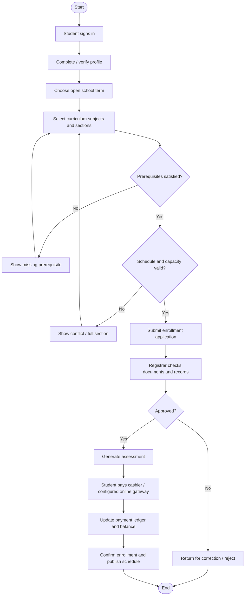

# Enrollment Activity Diagram

Note: The diagram describes the target complete operation. The current starter UI implements application submission and payment recording; subject cart validation, registrar approval actions and automated assessment generation are explicitly listed as completion work in README.
