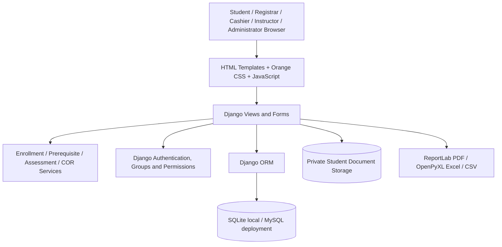
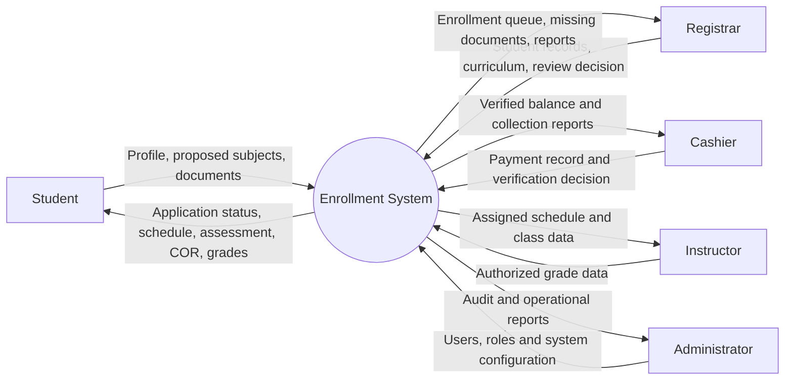
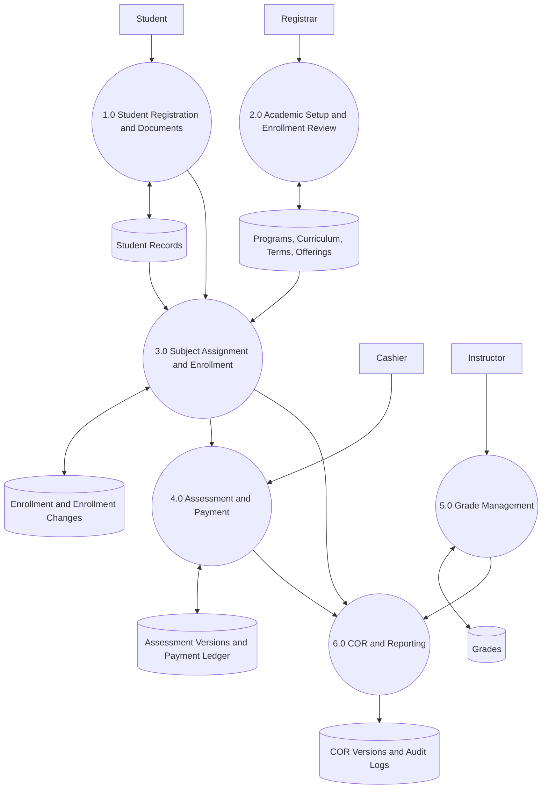
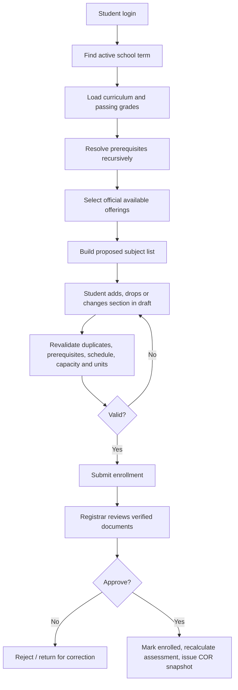
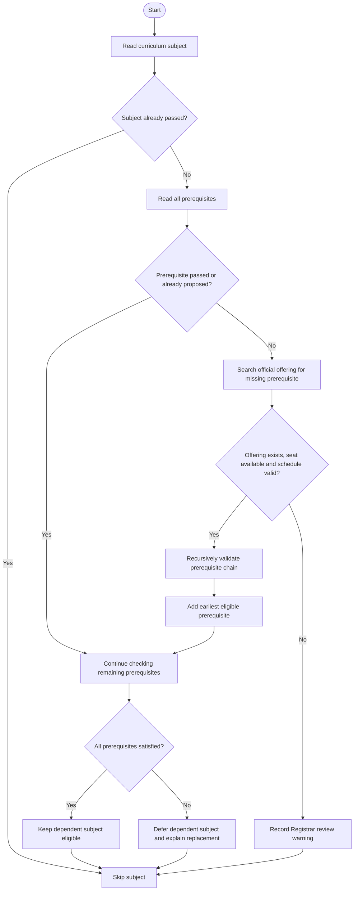
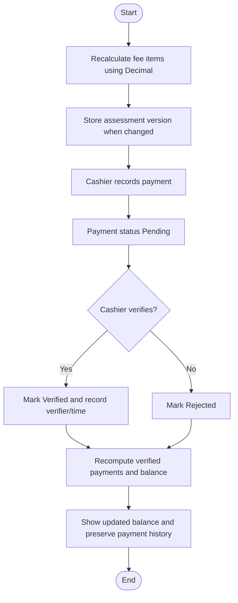

# Architecture and Workflow Diagrams

## System architecture

## Context diagram

## DFD Level 0

## DFD Level 1 — enrollment processing

## Activity — prerequisite checking and replacement

## Activity — payment and assessment

## Scope notes

- Public admission intake and Registrar approval, academic-history records, student draft planner, prerequisite recursion, document submission/verification, Registrar approval, assessment snapshots, and versioned COR are implemented.
- Post-approval add/drop requests are submitted by students and applied only after Registrar approval during the configured add/drop period; assessment and COR are revised.
- Instructor rosters and assigned-class grade encoding are implemented with server-side ownership checks.
- ClassSchedule validation is invoked on model save and serializes conflicting room/instructor writes with row locks where supported. Database-specific exclusion constraints remain a recommended production hardening.
- Student payment proof upload, Cashier/Administrator verification and internal acknowledgment receipts are implemented. Live provider checkout and provider-specific signed webhooks require merchant onboarding and credentials.
- The Reports page provides 12 operational/financial report datasets with CSV/Excel/PDF export.

## Password recovery

Students and staff (including instructors, cashiers, registrars, and administrators) can request a password reset from the shared login page using the email address registered to their user account. Django generates a single-use, time-limited token and sends the reset link. Registrar/Administrator users can trigger the same email workflow from a student profile. Staff do not view or choose the student's password. Local development uses the console email backend, which prints messages in the server terminal; actual email delivery requires institution-approved SMTP settings.
